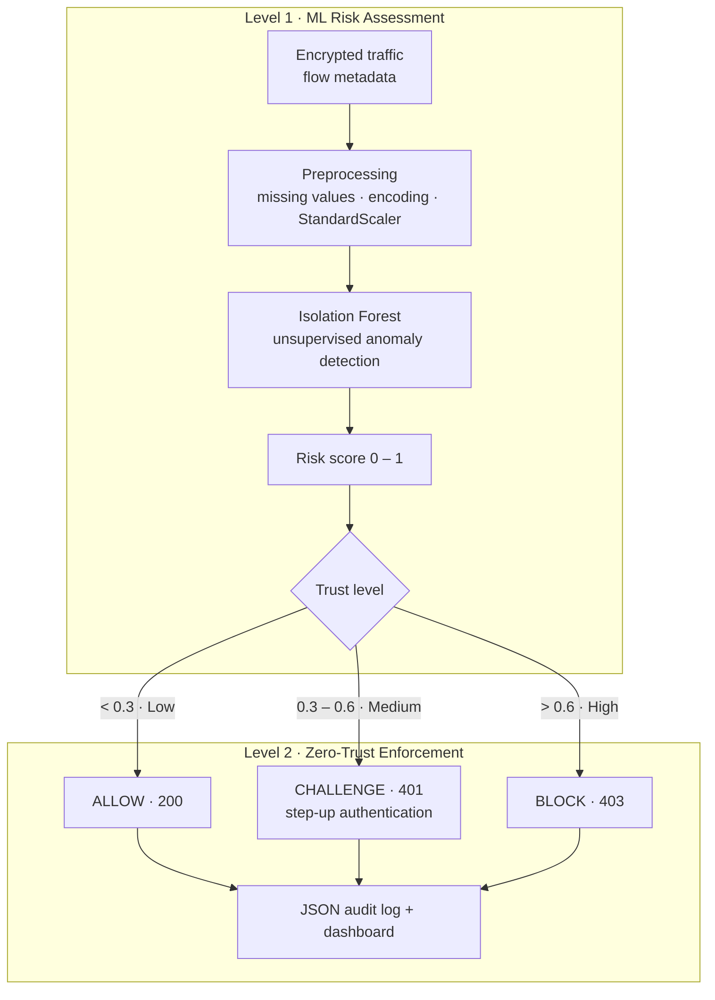

# Self-Adaptive Zero-Trust Security Layer for Encrypted Network Applications

**A two-level security framework. It detects anomalies in encrypted traffic from flow metadata alone, with no payload decryption, and turns the resulting risk scores into adaptive Zero-Trust decisions: ALLOW, CHALLENGE or BLOCK.**

> *"Never trust, always verify."* Every network flow gets a fresh trust evaluation.

---

## Why

TLS/SSL protects privacy, but it also blinds traditional IDS/IPS that rely on deep packet inspection. Attackers use encrypted channels for C2, malware delivery and data exfiltration. Most existing work does either ML detection **or** Zero-Trust enforcement. This project **combines both** in one adaptive architecture.

## Architecture



## Method

| Stage | Details |
|---|---|
| **Dataset** | UNSW-NB15: normal traffic plus Fuzzers, Exploits, DoS, Generic and Reconnaissance attacks |
| **Features** | Metadata only: duration, packet counts, packet rate, protocol, source/destination bytes. Privacy-preserving, so no payloads are read |
| **Preprocessing** | Missing-value handling, categorical encoding, StandardScaler, removal of irrelevant attributes |
| **Level 1** | Isolation Forest isolates anomalies with random partitions. Shorter path length means more anomalous. Scores are min-max scaled into a risk score in [0, 1] |
| **Level 2** | A policy engine maps trust level to an action, a response code and a reason, and writes a traceable JSON record per flow |

**Example enforcement record**

```json
{
  "flow_id": 1042,
  "risk_score": 0.47,
  "trust_level": "MEDIUM",
  "action": "CHALLENGE",
  "description": "Step-up authentication required",
  "response_code": 401,
  "timestamp": "2026-03-14T10:22:31",
  "reason": "Suspicious behaviour pattern based on risk score",
  "metadata": {"dur": 0.82, "spkts": 14, "dpkts": 12, "sbytes": 1580, "dbytes": 942, "rate": 31.7}
}
```

## Results

Evaluated on **15,018 network flows**:

| Trust level | Action | Flows | Share |
|---|---|---|---|
| Low risk | ALLOW | 12,789 | 85.2% |
| Medium risk | CHALLENGE | 1,472 | 9.8% |
| High risk | BLOCK | 757 | 5.0% |

- Most flows fall below the low-risk threshold (0.3). Anomalies form a small tail, as expected in real traffic.
- The confusion matrix against ground-truth labels shows normal flows are mostly identified correctly, while suspicious flows are escalated for verification.
- The dashboards show the risk distribution, a risk timeline with thresholds, and cumulative ALLOW / CHALLENGE / BLOCK counts.

## Project Structure

```
Self-Adaptive-Zero-Trust-Security-Layer/
├── data/                       # UNSW-NB15 training/testing CSVs
├── src/
│   ├── level1_risk_assessment.py
│   ├── level2_enforcement.py
│   └── dashboard.py
├── config/policies.json        # thresholds and actions
├── outputs/                    # risk scores, enforcement logs, plots
└── requirements.txt
```

## Getting Started

```bash
pip install -r requirements.txt
# Download UNSW-NB15 (UNSW_NB15_training-set.csv) into data/
python src/level1_risk_assessment.py --data data/UNSW_NB15_training-set.csv
python src/level2_enforcement.py
python src/dashboard.py
```

## Future Work

- Real-time deployment in enterprise networks (streaming flow capture)
- Integration with cloud security platforms
- Deep-learning anomaly detectors (autoencoders, LSTMs)
- Threat-intelligence feed integration

## Tech Stack

Python · scikit-learn · pandas · NumPy · Matplotlib · Seaborn

## References

1. S. Rose et al., "Zero Trust Architecture," NIST SP 800-207, 2020.
2. F. T. Liu, K. M. Ting, Z. Zhou, "Isolation Forest," IEEE ICDM, 2008.
3. N. Moustafa & J. Slay, "UNSW-NB15: A Comprehensive Data Set for Network Intrusion Detection Systems," MilCIS, 2015.
4. M. Gambo & A. Almulhem, "A Survey on Zero Trust Security Architecture: Challenges and Future Directions," IEEE Access, vol. 11, 2023.

## Team

Team 12 · Department of Artificial Intelligence, Amrita Vishwa Vidyapeetham, Coimbatore · Guide: Ms. Likha O V

- Dodla Nithya Sai
- M. Vishnu Vardhan
- P. Sreekar Reddy
- S. Beena Reddy
